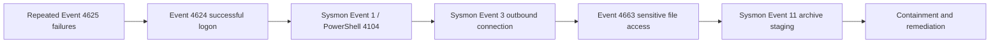

# SOC Incident Investigation Lab

A lightweight, reproducible Security Operations Center (SOC) portfolio project that detects and investigates a simulated Windows account compromise. The lab accepts JSONL telemetry and Windows EVTX files, correlates a complete attack chain, and produces JSON, Markdown, and interactive HTML reports.

The project is designed to demonstrate practical alert triage and incident-response skills without running malware, attacking an external system, or requiring a resource-heavy SIEM.

## Investigation scenario

An external source performs repeated failed logons against a workstation account. The same source then authenticates successfully. Minutes later, PowerShell runs an encoded download command, connects to an external documentation-range address, and accesses a file marked confidential.



## What this demonstrates

- Windows Security Event and Sysmon analysis
- Native Windows EVTX ingestion
- Safe read-only Windows event collection
- Multi-event correlation and alert triage
- Brute-force and suspicious PowerShell detection
- Network and sensitive-file-access investigation
- MITRE ATT&CK mapping
- Sigma detection engineering
- Incident timeline and report writing
- Automated testing and repeatable evidence generation
- Interactive browser-based case dashboard

## Repository map

| Path | Purpose |
| --- | --- |
| `src/soc_lab/` | Dependency-free Python analyzer and CLI |
| `collectors/` | Read-only Windows event export script |
| `data/sample_events.jsonl` | Clearly labeled synthetic Windows/Sysmon telemetry |
| `detections/sigma/` | Portable Sigma detection rules |
| `scripts/verify.ps1` | One-command verification and report generation |
| `docs/investigation-timeline.md` | Analyst timeline with evidence |
| `docs/incident-report.md` | Executive and technical incident report |
| `docs/analyst-playbook.md` | Repeatable account-compromise response process |
| `docs/portfolio-guide.md` | Resume bullets and interview talking points |
| `docs/validation.md` | Test scope and real EVTX compatibility evidence |
| `docs/architecture.md` | Detection pipeline and design decisions |
| `tests/` | Automated detection and false-positive tests |

## Quick start

Requires Python 3.11 or newer. JSONL analysis uses only the Python standard library. EVTX support installs one optional parser.

```powershell
python -m pip install -e ".[dev]"
.\scripts\verify.ps1
start output\dashboard.html
```

Expected result: five correlated findings, a risk score of **100/100**, and a critical account-compromise classification.

A generated dashboard is included at [`artifacts/sample-dashboard.html`](artifacts/sample-dashboard.html) so reviewers can inspect the finished case without rerunning the analyzer.

## Input options

Analyze the included safe dataset:

```powershell
python -m soc_lab data\sample_events.jsonl --html output\dashboard.html
```

Analyze an authorized EVTX file:

```powershell
python -m soc_lab C:\Evidence\Security.evtx --json output\security.json --html output\security.html
```

Collect selected logs from the local Windows endpoint, then analyze them:

```powershell
.\collectors\Export-SocTelemetry.ps1 -Hours 24 -OutputPath output\windows_events.jsonl
python -m soc_lab output\windows_events.jsonl --html output\windows_dashboard.html
```

The collector reads event logs only. It does not change audit policy, logging settings, services, or security controls.

## Detection coverage

| Detection | Primary evidence | MITRE ATT&CK |
| --- | --- | --- |
| Brute force followed by success | 4625 → 4624 | T1110, T1078 |
| Suspicious PowerShell | 4104 / Sysmon 1 | T1059.001, T1105 |
| Suspicious outbound connection | Sysmon 3 | T1071.001 |
| Sensitive file access | 4663 | T1005 |
| Sensitive archive staging | Sysmon 11 | T1560.001 |

## Analyst conclusion

The evidence supports a **true positive** account compromise with post-authentication execution and probable collection activity. Recommended immediate actions are to isolate the workstation, disable and reset the affected account, revoke active sessions, block the observed infrastructure, preserve volatile evidence, and scope the environment for related indicators.

See the full [incident report](docs/incident-report.md), [investigation timeline](docs/investigation-timeline.md), [response playbook](docs/analyst-playbook.md), [validation record](docs/validation.md), and [portfolio guide](docs/portfolio-guide.md).

## Data and safety statement

All telemetry is synthetic. Names, hosts, hashes, addresses, and paths were created for this lab. The IP addresses use RFC 5737 documentation ranges and do not represent real infrastructure. No malware is included or executed.
